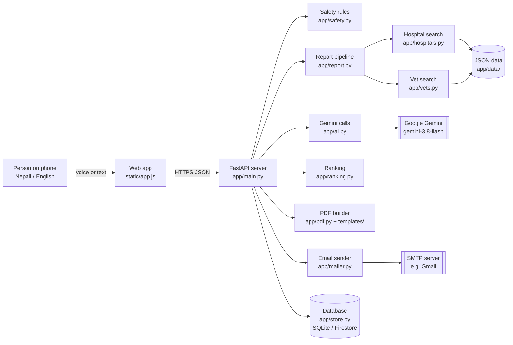
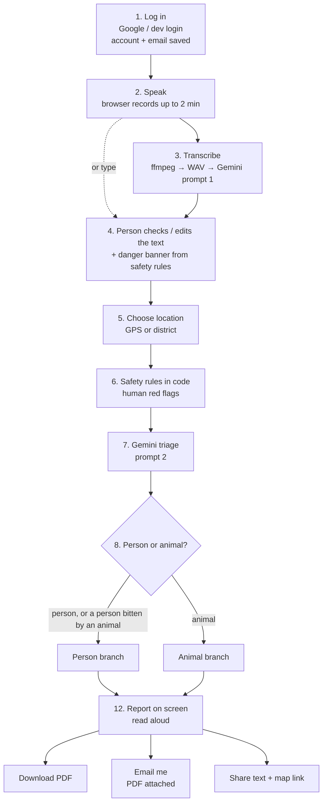
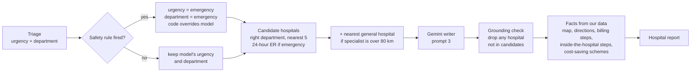
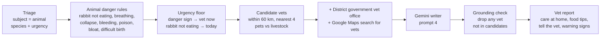
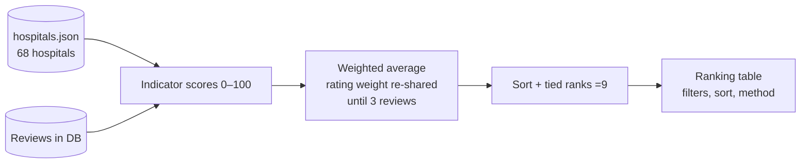

# Matrix — how the pipeline works

A reference for workflow diagrams and slides. Every box below maps to a real file and function.
Mermaid diagrams render on GitHub; paste them into mermaid.live, draw.io (Arrange → Insert → Mermaid)
or Excalidraw (Mermaid to Excalidraw) to restyle them.

**In one sentence:** a person speaks a health problem (their own, a family member's, or their animal's) in
Nepali; code checks for danger signs, Gemini works out urgency and where to go, our own data supplies the real
hospitals or vets, Gemini explains the choice in simple Nepali, and the person gets a report on screen, as a PDF,
or by email.

**Core idea for the slides:** *the AI explains, our data decides the facts.* Gemini never invents a hospital,
vet, phone number, price, distance or map link — it may only choose from candidates our code built, and
anything else is thrown away.

---

## 1. System overview

| Layer | Technology | File(s) |
|---|---|---|
| Web app | Plain HTML/CSS/JavaScript, no build step, Nepali-first | `static/index.html`, `static/app.js`, `static/i18n.js`, `static/styles.css` |
| API server | Python, FastAPI, Uvicorn | `app/main.py` |
| AI | Google Gemini via `google-genai` (API key locally, Vertex AI on Cloud Run) | `app/ai.py` |
| Safety | Plain Python keyword rules (English, Nepali, romanized Nepali) | `app/safety.py` |
| Report logic | Python | `app/report.py`, `app/hospitals.py`, `app/vets.py` |
| Ranking | Python | `app/ranking.py` |
| PDF | WeasyPrint + Jinja2 HTML template, Mukta font, QR codes | `app/pdf.py`, `app/templates/report.html`, `app/templates/report_animal.html` |
| Email | Python `smtplib` (SMTP) | `app/mailer.py` |
| Database | SQLite (local) / Firestore (Cloud Run) | `app/store.py` |
| Login | Firebase Authentication (Google) / dev login locally | `app/auth.py` |
| Hosting | Docker → Google Cloud Run (Mumbai) + Firebase Hosting for the domain | `Dockerfile`, `deploy.sh`, `firebase.json` |

---

## 2. Where the prompts are

All prompts live in **`app/ai.py`**. Every call that the app relies on returns **JSON with a fixed schema**
(a Pydantic model), so the code never has to guess what the model meant.

| # | Prompt | Purpose | Input | Output (schema) | Temperature |
|---|---|---|---|---|---|
| 1 | `TRANSCRIBE_PROMPT` | Speech → text, Nepali in Devanagari, no translation | Audio (WAV 16 kHz mono) | Plain text | 0.0 |
| 2 | `TRIAGE_PROMPT` | Person or animal? How urgent? Which department? Where is the person? | Transcript | `Triage` | 0.1 |
| 3 | `REPORT_PROMPT` | Write the hospital guide, choosing only from candidate hospitals | Transcript, triage, department, location, candidate hospitals | `ReportText` | 0.3 |
| 4 | `VET_PROMPT` | Write the animal guide, choosing only from candidate vets | Transcript, animal, urgency, danger signs, location, district vet office, candidate vets | `VetReportText` | 0.3 |

**Models:** `gemini-3.8-flash` for all four (set by `SPEECH_MODEL`, `TRIAGE_MODEL`, `REPORT_MODEL` in
`app/config.py` / `.env`). If a model is busy (503), rate-limited (429) or retired (404), `_generate()` tries
the fallbacks `gemini-3.7-flash → gemini-3.5-flash → gemini-3.5-flash-lite → gemini-3.1-flash-lite`, waits
2 seconds, and tries the whole list once more (`FALLBACK_MODELS`).

**Schemas (what each call must return):**

- `Triage`: `is_health_problem`, `subject` (person | animal), `animal`, `patient`, `key_symptoms`, `duration`,
  `urgency` (emergency | urgent | soon | routine), `department` (one of 20), `alternative_department`,
  `district_mentioned`, `cost_worry`.
- `ReportText`: `title`, `summary`, `urgency_reason`, `do_now`, `department_reason`, `picks`
  (hospital id + why), `what_to_bring`, `questions_for_doctor`, `warning_signs`, `travel_tip`.
- `VetReportText`: `title`, `summary`, `urgency_reason`, `do_now`, `care_at_home`, `food_tips`, `picks`
  (vet id + why), `tell_the_vet`, `warning_signs`, `travel_tip`.

**Rules written into the prompts:** not a doctor/vet, no diagnosis, no medicines or doses, never human
medicines for animals, choose only from the candidate list by id, never invent hospitals/phones/prices/hours,
an emergency must start with "call 102 / go now" (people) or "take it to a vet now" (animals), simple words for
people with little education.

---

## 3. The report pipeline, end to end

### Step by step

| Step | What happens | Where |
|---|---|---|
| 1. Log in | Google sign-in (Firebase) or dev login (name + email). `POST /api/login` saves the account: name, email, first/last login, login count. Voice and reports need login; browsing and the ranking do not. | `app.js: devLogin, syncLogin` · `main.py: login` · `store.py: record_login` |
| 2. Speak | Browser `MediaRecorder` records webm/mp4/ogg, up to 2 minutes and 8 MB. "Type instead" skips to step 4. | `app.js: toggleRecording` |
| 3. Transcribe | `POST /api/transcribe`. ffmpeg converts to 16 kHz mono WAV; Gemini (prompt 1) returns the transcript in Devanagari. | `main.py: transcribe` · `ai.py: to_supported_audio, transcribe` |
| 4. Confirm | The person sees what we heard and can correct it. The safety rules already run here: a red banner appears if there are danger signs ("Call 102" for people, "see a vet" for animals). | `safety.py: banner_check` · `app.js: viewHelp, alarmBox` |
| 5. Location | GPS (inside Nepal only) or a district; also read from the text by triage (`district_mentioned`). | `app.js: openPlace, getGps` · `hospitals.py: origin_from` |
| 6. Safety rules | Deterministic red-flag rules in Python run **before** the AI: chest pain, breathing trouble, unconsciousness, stroke signs, heavy bleeding, pregnancy bleeding, snake bite, poisoning, suicidal thoughts and more. They prefer false alarms over missed emergencies. | `safety.py: check_text, RULES` |
| 7. Triage | Gemini (prompt 2) fills the `Triage` schema: person or animal, urgency, department, district. | `ai.py: triage` |
| 8. Branch | Animal → animal branch, **unless** the text describes a bite or scratch (rabies risk for a person), which always stays in the person branch. | `report.py: build_report` · `safety.py: animal_bite` |
| 9–11 | See the two branches below. | |
| 12. Report | Shown on screen; can be read aloud with the browser's speech (no server cost). | `app.js: viewReport, viewAnimalReport, speak` |
| 13. Deliver | **PDF**: `POST /api/report/pdf` (WeasyPrint, Nepali font, QR code for directions). **Email**: `POST /api/report/email` builds the same PDF and sends it to the account's email. **Share**: phone share sheet or clipboard. Nothing is stored. | `pdf.py` · `mailer.py` · `main.py: report_pdf, report_email` |

### Person branch (hospital report)

1. **Override:** if a safety rule fired, urgency and department become `emergency`, whatever the model said.
2. **Candidates** (`hospitals.candidates`): hospitals that have the department, nearest first (5); for an
   emergency only those with a 24-hour emergency department. If the nearest specialist is more than 80 km
   away, the nearest general hospital is added so the person can be examined there first and referred.
3. **Writer** (prompt 3): writes the guide and picks 1–3 hospitals **by id** from the candidates.
4. **Grounding check:** any id not in the candidate list is dropped; if nothing valid is left, the nearest
   candidate is used.
5. **Facts from data, never from the model:** map embed and Google Maps directions, billing steps for that
   type of hospital (government / private / community, with or without health insurance), steps to find the
   department inside, programmes that may lower the cost (`schemes.json`), patient ratings from our reviews.

### Animal branch (vet report)

1. **Animal danger rules** (`safety.check_animal`): a rabbit or guinea pig that stops eating (can become
   seriously ill within a day), breathing trouble, collapse or fits, heavy bleeding or injury, poison, bloat
   or difficult birth. Human red flags in an animal question ("my dog can't breathe") also count.
2. **Urgency floor:** any danger sign → "Emergency: take it to a vet now"; rabbit/guinea pig not eating →
   at least "See a vet today". The model can raise urgency but never lower it below the floor.
3. **Candidates** (`vets.candidates`): vets from `vets.json` within 60 km, nearest 4, skipping pet-only clinics
   for farm animals and the reverse.
4. **Always-available options:** the district's government *Veterinary Hospital and Livestock Service Expert
   Centre* (every district has one) and a Google Maps search for vets around the person — these work even
   where our list has no clinic.
5. **Writer** (prompt 4) → **grounding check** → report with care at home, food and water tips, what to tell the
   vet, warning signs. It must say never to give human medicines.

**Example** — "मेरो खरायोले कति दिन भयो केही पनि नखाको, एउटै ठाउँमा मात्रै बसिराख्छ। ... एनिमल हस्पिटल कतै छ त?"
(Kathmandu): subject = animal, species = rabbit, rule "rabbit not eating" → urgency *आजै पशु चिकित्सकलाई
देखाउनुहोस्* (see a vet today); three real clinics within 1.6 km from OpenStreetMap, the Kathmandu district vet
office, a map search; advice to keep it warm and quiet, offer hay and water, no bread or sweets, no human medicine.

---

## 4. Safety: defence in depth (good slide)

| Layer | What it guarantees | Where |
|---|---|---|
| 1. Rules before AI | Emergencies are found by plain code, even if Gemini is wrong or down | `safety.py` |
| 2. Code overrides model | A fired rule forces emergency; animal rules set an urgency floor | `report.py` |
| 3. AI-down fallback | If the report fails, the emergency banner still shows | `main.py: make_report` |
| 4. Structured output | Every model answer must match a JSON schema | `ai.py: _json_call` |
| 5. Grounding | Only candidate hospitals/vets survive; facts come from our data | `report.py` |
| 6. Prompt rules | No diagnosis, no medicines or doses, no invented places | `ai.py` prompts |
| 7. Bite stays human | An animal bite on a person is never routed to a vet | `safety.py: animal_bite` |
| 8. Link checks | PDF/email only accept Google Maps links (no tampered links) | `main.py: PdfReport` |
| 9. Limits | Per-user daily limits: 60 transcriptions, 30 reports, 100 PDFs, 10 emails | `auth.py: check_limit` |
| 10. Privacy | Voice and reports are not stored; reviews show first name + initial | `main.py`, `auth.py` |

---

## 5. Hospital ranking (landing page)

| Indicator | Weight | Score |
|---|---|---|
| Specialties | 35% | departments ÷ most departments of any hospital × 100 |
| Emergency care | 20% | 100 with a 24-hour emergency department, else 0 |
| Patient rating | 20% | (average stars − 1) ÷ 4 × 100, only after 3 reviews ("pending" before) |
| Insurance | 15% | 100 if it accepts the national health insurance, else 0 |
| Teaching & referral | 10% | teaching 100, specialty centre 50, other 0 |

`GET /api/ranking` → `ranking.build()`. The page states that scores reflect listed information, not quality
of care, and that specialist centres score low on breadth by design.

---

## 6. Data

| File | Contents | Source |
|---|---|---|
| `app/data/hospitals.json` | 68 hospitals, all 7 provinces, Nepali names, departments, 24-hour ER, insurance | Seed data, unverified; more via `scripts/import_osm.py` |
| `app/data/vets.json` | 109 vet clinics and animal hospitals | OpenStreetMap via `scripts/import_vets.py` (shops and farms filtered out) + 1 seed; unverified |
| `app/data/departments.json` | 20 departments with Nepali/English labels and explanations | Hand-written |
| `app/data/billing.json` | How billing works by hospital type, with/without insurance; steps inside a hospital | Hand-written |
| `app/data/districts.json` | 77 districts with coordinates and spelling variants | Hand-written |
| `app/data/schemes.json` | Government programmes that lower costs | Hand-written |
| Database `users` | uid, name, email, first/last login, login count | `store.py` |
| Database `reviews` | One review per user per hospital: stars, comment, dates | `store.py` |

---

## 7. API

| Method | Path | Login | Does |
|---|---|---|---|
| GET | `/api/config` | – | Start-up settings (login mode, districts, departments, email on/off) |
| GET | `/api/ranking` | – | Ranked hospitals, indicators, weights, stats |
| GET | `/api/hospitals`, `/api/hospitals/{id}` | – | Directory search; one hospital with map, billing, reviews |
| POST | `/api/login` | ✓ | Save the account and email after sign-in |
| GET / PUT | `/api/me` | ✓ | Read / change the account email |
| POST / DELETE | `/api/hospitals/{id}/reviews` | ✓ | Post or delete my review |
| POST | `/api/transcribe` | ✓ | Voice → text + danger banner |
| POST | `/api/report` | ✓ | Text → hospital or vet report |
| POST | `/api/report/pdf` | ✓ | Report → PDF download |
| POST | `/api/report/email` | ✓ | Report → PDF by email to the account address |

---

## 8. Suggested slides

1. **Problem** — in Nepal people often don't know which hospital or department to go to, how billing works,
   or where the nearest vet is; many can't type or read English.
2. **Solution** — speak in Nepali, get a simple guide: where to go, what to do now, how to pay, as a PDF or email.
3. **Demo flow** — diagram from section 3 (log in → speak → check text → report → PDF/email).
4. **How the AI is used** — the four prompts in section 2; structured JSON; model fallbacks.
5. **The AI explains, our data decides** — person branch diagram + grounding check.
6. **Animals too** — animal branch diagram + the rabbit example.
7. **Safety by design** — the defence-in-depth table in section 4.
8. **Open ranking** — ranking diagram + weights; honest about limits.
9. **Architecture** — system overview diagram in section 1; Cloud Run + Firestore + Vertex AI + Firebase.
10. **Impact and next steps** — verify hospital and vet data with partners, more reviews, more districts,
    clinician and vet review of the safety rules.
